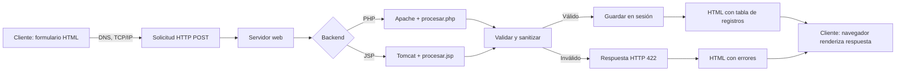
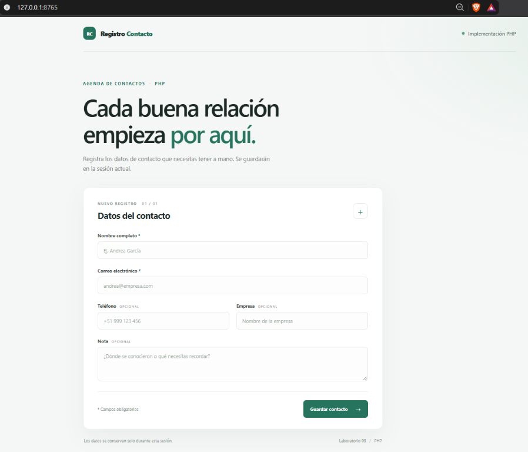
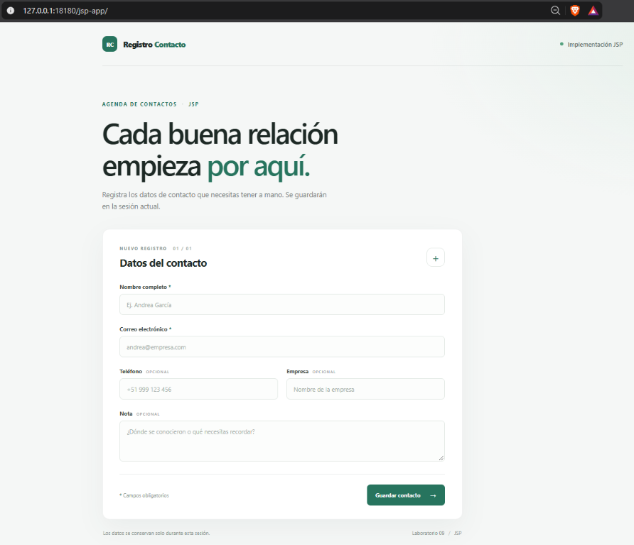

# Sistema de Registro de Contacto

Implementación del Laboratorio 09 de Desarrollo de Aplicaciones Web: el mismo formulario de contactos funciona en PHP y JSP. Cada versión valida los datos en el servidor, guarda los registros en la sesión del navegador y presenta una tabla con los contactos de esa sesión.

## Estructura

```text
practica-grupal/
├── php-app/
│   ├── index.html
│   ├── procesar.php
│   └── style.css
├── jsp-app/
│   ├── index.html
│   ├── procesar.jsp
│   └── style.css
├── evidencias/
│   ├── estructura.txt
│   ├── http-pruebas.txt
│   ├── jsp-formulario.png
│   ├── jsp-readme.png
│   ├── php-formulario.png
│   ├── php-readme.png
│   ├── php-server.log
│   ├── tomcat-launch.txt
│   └── tomcat-server.log
└── README.md
```

Los registros son temporales y no se escriben en una base de datos. Cada navegador conserva su propia sesión; se muestran como máximo los 100 registros más recientes.

## Requisitos

- **PHP:** PHP 8.1 o superior con sesiones habilitadas; XAMPP incluye Apache y PHP.
- **JSP:** JDK 8 o superior y Apache Tomcat 8.5 o superior (Tomcat 9+ es recomendable para despliegues nuevos).
- Navegador web moderno. Los estilos y las fuentes de reserva son locales; no se requieren recursos externos.

## Despliegue PHP con XAMPP

1. Copia la carpeta `php-app` dentro de `C:\xampp\htdocs\`.
2. Inicia **Apache** desde el panel de XAMPP.
3. Abre `http://localhost/php-app/`.
4. Completa el formulario y pulsa **Guardar contacto**. La respuesta muestra el contacto recién agregado y los anteriores de la misma sesión.
5. Comprueba los registros de Apache en `C:\xampp\apache\logs\access.log` y `C:\xampp\apache\logs\error.log`.

No se requiere Composer ni una base de datos.

## Despliegue JSP con Tomcat

1. Copia la carpeta `jsp-app` dentro de la carpeta `webapps` de Tomcat. Por ejemplo: `C:\apache-tomcat-10\webapps\jsp-app\`.
2. Inicia Tomcat. La primera visita compila `procesar.jsp` automáticamente.
3. Abre `http://localhost:8080/jsp-app/`.
4. Completa el formulario y pulsa **Guardar contacto**.
5. Revisa `logs\catalina.*.log` para mensajes del servidor. Si el registro de acceso está habilitado, revisa también `logs\localhost_access_log.*.txt`.

Esta versión usa objetos implícitos y clases estándar de Java/JSP; no necesita JSTL, `web.xml` ni bibliotecas adicionales.

## Flujo HTTP



1. El navegador resuelve el host mediante DNS y establece una conexión TCP/IP con Apache o Tomcat.
2. El cliente envía una solicitud `POST` con los campos del formulario.
3. El servidor enruta la solicitud a `procesar.php` o `procesar.jsp`; ambos rechazan métodos distintos de `POST` con `405 Method Not Allowed`.
4. El backend valida los campos, conserva los registros en la sesión y genera HTML escapado. Los datos inválidos reciben `422 Unprocessable Content`.
5. El navegador recibe la respuesta HTTP y renderiza la tabla o los mensajes de validación.

## Validación y seguridad

- Nombre obligatorio (máximo 80 caracteres); correo obligatorio y validado en el servidor.
- Teléfono, empresa y nota son opcionales; se verifican formato y límites de longitud en el servidor.
- Los datos se recortan y se escapan para HTML al renderizar, evitando que entradas se interpreten como marcado o JavaScript (XSS almacenado).
- Solo se acepta `POST` para procesar registros. Los errores de método y validación devuelven códigos `405` y `422`; un fallo al iniciar sesión PHP devuelve `500`.
- PHP establece la cookie de sesión como `HttpOnly`, `SameSite=Lax` y `Secure` cuando la conexión usa HTTPS.
- No guardar información sensible: los registros son demostrativos y permanecen únicamente en la sesión.

La validación HTML del navegador mejora la experiencia, pero no sustituye la validación del servidor. La aplicación no incorpora autenticación, persistencia en base de datos ni protección CSRF; no está diseñada para exponer registros personales en producción.

## Matriz comparativa: PHP vs JSP

| Aspecto | PHP | JSP |
|---|---|---|
| Ciclo de vida | Apache ejecuta `procesar.php` al recibir la solicitud; PHP procesa y devuelve HTML en esa petición. | Tomcat traduce la primera solicitud JSP a un servlet, lo compila y ejecuta el servlet en las solicitudes siguientes. |
| Despliegue | Copiar `php-app` a `htdocs`; iniciar Apache desde XAMPP. | Copiar `jsp-app` a `webapps`; iniciar Tomcat y contar con un JDK. |
| Parámetros HTTP | `$_SERVER['REQUEST_METHOD']` y `$_POST`. | `request.getMethod()` y `request.getParameter(...)`. |
| Sesión | `session_start()` y `$_SESSION['registros']`. | Sesión implícita `session` y `session.getAttribute/setAttribute("registros", ...)`. |
| Validación y salida segura | `filter_var`, expresiones regulares y `htmlspecialchars`. | Validación Java y función `escapeHtml` antes de imprimir valores. |
| Rendimiento | Arranque sencillo y adecuado para sitios pequeños; depende de la configuración de Apache/PHP. | JSP compilado a servlet y ejecutado en la JVM; la compilación inicial puede añadir latencia. |
| Ecosistema y mantenimiento | Instalación y configuración simples para prototipos web PHP. | Integración natural con bibliotecas Java y aplicaciones desplegadas en contenedores servlet. |

La medición de rendimiento requiere el mismo hardware, carga y configuración para ambas pilas; la tabla describe el ciclo de ejecución, no presenta cifras de benchmark.

## Pruebas manuales y evidencias

Realiza estas comprobaciones en **cada** despliegue:

1. Enviar nombre, correo y campos opcionales válidos: debe responder `200`, mostrar el contacto y conservarlo al registrar otro en el mismo navegador.
2. Enviar un correo mal formado mediante una solicitud HTTP o desactivar la validación HTML del navegador: debe responder `422`, mostrar errores y no agregar el registro.
3. Abrir `procesar.php` o `procesar.jsp` con `GET`: debe responder `405` e incluir `Allow: POST`.
4. Enviar como nombre el texto `<script>alert(1)</script>`: la respuesta debe mostrarlo como texto escapado, sin ejecutarlo.
5. Inspeccionar las herramientas de desarrollador del navegador, pestaña **Red/Network**, para guardar capturas del código de respuesta y formulario funcionando. Captura también la tabla después de registrar un contacto.
6. La carpeta `evidencias/` incluye capturas de los formularios, logs reales de la prueba local, resultados HTTP y la estructura del proyecto. En el despliegue del laboratorio, agrega también las capturas propias de Apache y Tomcat.

## Evidencias generadas

- `evidencias/php-formulario.png` y `evidencias/jsp-formulario.png`: capturas de los formularios desplegados.
- `evidencias/php-readme.png` y `evidencias/jsp-readme.png`: capturas proporcionadas para esta entrega y mostradas a continuación.
- `evidencias/http-pruebas.txt`: resultados reales para `200`, `405`, `422`, sesiones y escape XSS en ambas implementaciones.
- `evidencias/php-server.log` y `evidencias/tomcat-server.log`: logs de las ejecuciones locales de prueba.
- `evidencias/estructura.txt`: estructura de carpetas entregada.

### Captura del formulario PHP



### Captura del formulario JSP



### Ejemplos HTTP con curl

Ejecuta estos ejemplos con el servidor correspondiente. `-i` muestra el estado y las cabeceras; `-c` y `-b` conservan la cookie de sesión entre solicitudes.

```powershell
# PHP: formulario servido por XAMPP en localhost
curl.exe -i -c php-cookies.txt -b php-cookies.txt -X POST http://localhost/php-app/procesar.php `
  -d "nombre=Andrea Garcia" -d "correo=andrea@example.com" -d "telefono=%2B51 999 123 456"

# La misma sesión PHP: solicitud inválida, respuesta esperada 422
curl.exe -i -c php-cookies.txt -b php-cookies.txt -X POST http://localhost/php-app/procesar.php `
  -d "nombre=Andrea" -d "correo=no-es-correo"

# JSP en Tomcat
curl.exe -i -c jsp-cookies.txt -b jsp-cookies.txt -X POST http://localhost:8080/jsp-app/procesar.jsp `
  -d "nombre=Andrea Garcia" -d "correo=andrea@example.com"

# Método no permitido: respuesta esperada 405 y cabecera Allow: POST
curl.exe -i http://localhost/php-app/procesar.php
curl.exe -i http://localhost:8080/jsp-app/procesar.jsp
```

## Organización del trabajo

Para un equipo de hasta dos integrantes, se pueden distribuir los roles de esta manera:

| Rol | Responsabilidad |
|---|---|
| Despliegue | Configurar XAMPP/Tomcat, rutas, puertos y revisar logs. |
| Desarrollo PHP | Formulario, validación, sesión, salida HTML segura y respuestas HTTP. |
| Desarrollo JSP | Parámetros `request`, sesión, validación y respuesta HTML estructurada. |
| QA y documentación | Probar casos válidos, inválidos y de seguridad; completar matriz y guardar evidencias reales. |

Si el equipo tiene dos integrantes, cada uno puede tomar una implementación como responsable y realizar revisión cruzada de las pruebas y la documentación.
